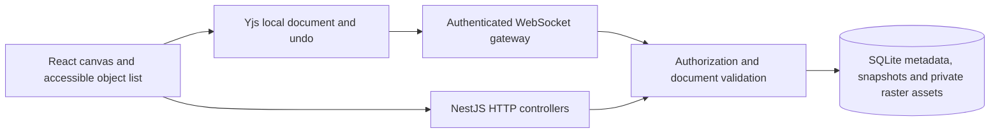

# Collaborative Whiteboard architecture

Contents: [Scope](#1-scope-and-acceptance), [Decisions](#2-decisions),
[Design](#3-design-discovery-2026-11-06), [Contracts](#4-structure-and-contracts),
[Ownership](#5-source-ownership-and-domain-model), [API](#6-http-and-websocket-contracts),
[Recovery](#7-collaboration-failure-and-recovery), [Security](#8-security-privacy-and-egress),
[Accessibility](#9-ui-content-and-accessibility), [Build](#10-build-quality-and-local-lifecycle),
[Traceability](#11-requirement-traceability), [Historical checks](#12-verification),
[Extensions](#13-extension-and-recovery-notes), [Earlier review](#14-universal-standard-security-review---2026-11-07),
[Current audit](#15-current-application-audit-2026-11-07), [Proposed rule changes](#16-proposed-agent-standard-refinements-awaiting-owner-approval).

## 1. Scope and acceptance

Desktop-first private whiteboards for owners, editors, commenters and viewers, with essential touch editing.
Keep the existing React / Vite / NestJS / Canvas architecture and ports 5603 / 5604. One Git repository at
the application root owns the frontend/backend packages, docs, tools and CI. It is on unborn `main`, with
source untracked and no remote. The original empty nested Git metadata is privately archived; no commits are made.

Plan: durable/authenticated vertical slice; collaborative canvas; sharing/assets/comments/export/history;
recovery/security/performance/accessibility validation; local launch.

Hypothesis: acknowledged board changes survive service recreation. Discriminating executable check:
open a fresh SQLite database, persist a Yjs update, close/reopen it and compare objects.

Acceptance: two clients converge after reconnect; persisted content survives refresh/restart; wrong users and
read-only roles cannot write through HTTP or WebSocket; users can create/edit/export a usable board.

## 2. Decisions

ADR-001: retain Canvas 2D and the existing geometry/rendering tests. tldraw's SDK has production licensing
conditions (https://tldraw.dev/community/license); Konva provides an MIT scene graph
(https://konvajs.org/docs/overview.html), but replacing the tested renderer adds migration cost. Native Canvas
has no additional runtime license. Explicit object navigation supplies a nonvisual alternative.

ADR-002: retain NestJS; use Yjs (MIT, https://github.com/yjs/yjs) with a small authenticated JSON WebSocket
protocol. Evaluate y-websocket/Hocuspocus: both provide richer transport machinery but still need application
authorization. Explicit validation, durable acknowledgement, bounded payloads and session revalidation are
easier to audit in this single-process local application. Presence is ephemeral and server-attributed.

ADR-003: use Node's built-in SQLite for this single-computer deliverable, rather than requiring Docker,
PostgreSQL and an object-store account. Prepared statements, foreign keys, transactions and schema migrations
provide real durability. Uploaded raster images live in protected database blobs. This is a local deployment
choice, not a horizontally scalable service. Exit: move repository methods to PostgreSQL and assets to private
object storage before multi-instance deployment. Node 22.13+ is required; SQLite is experimental on Node 22.

ADR-004 (2026-11-07): version the complete application in one root Git repository. Separate package manifests
and lockfiles define build/runtime boundaries; they do not require separate Git repositories. The former
frontend/backend repositories had no commits, index entries or remotes, so there was no history to merge.
Archive their metadata for recovery and remove active nested initialization. Retain the package layout and
installation commands; introducing npm workspaces or moving source would add unrelated migration work.
The optional VS Code workspace opens only `.` and resolves its dev tasks into the two package directories.

## 3. Design discovery (2026-11-06)

Sources inspected as live page text; visual browser inspection of references was not performed.

| Reference | Observed pattern / fit | Constraint / reuse |
| --- | --- | --- |
| https://excalidraw.com | Canvas-first drawing with sparse chrome; good for direct manipulation | MIT project; no source/assets copied; canvas needs alternative navigation |
| https://www.tldraw.com | Focused collaborative canvas product | SDK license evaluated separately; no branding/code reused |
| https://miro.com/online-whiteboard/ | Shapes, sticky notes, upload and collaboration jobs | Proprietary site; pattern research only; avoid heavy marketing chrome |

Directions compared: dark technical drafting versus warm paper studio. Choose the latter: ivory dotted
canvas, ink text, teal active tools, compact white tool surfaces and restrained amber sticky notes. System
fonts avoid external font requests. Controls use existing Lucide icons. Motion is limited to short state
transitions with reduced-motion support. No custom page scrolling library.

IA: sign-in -> workspace/board library -> board. Board has top navigation/sharing, left tools, contextual
object inspector, optional objects/comments/history panels, bottom zoom controls and collaboration status.
At narrow widths the library collapses and panels become overlays. Empty, loading, denied, disconnected,
pending-save and retry states are explicit. Keyboard shortcuts supplement labeled native controls.

## 4. Structure and contracts

## 5. Source ownership and domain model

| Boundary | Owner |
| --- | --- |
| Account / board navigation | `frontend/src/App.tsx`, `AuthScreen.tsx`, `Library.tsx` |
| Canvas state composition | `BoardEditor.tsx`, `BoardSession.tsx`, `BoardSidebar.tsx`, `BoardChrome.tsx` |
| Drawing, transforms and culling | `frontend/src/components/Canvas/` |
| CRDT lifecycle / local undo / reconnect | `frontend/src/lib/collaboration.ts` |
| Per-account device drafts | `frontend/src/lib/offline.ts` |
| Network validation / content | `frontend/src/lib/api.ts`, `contracts.ts`, `content.ts` |
| Private image conversion / export | `frontend/src/lib/uploads.ts`, `exports.ts` |
| Session identity / bounded password derivation | `backend/src/auth.ts`, `passwords.ts` |
| Resource-level authorization | `backend/src/boards.ts` |
| HTTP adaptation | `backend/src/*controller.ts` |
| Sharing / content invariants and transactions | `backend/src/sharing.service.ts`, `content.service.ts` |
| Reusable input validation / loopback perimeter | `backend/src/validation.ts`, `request-policy.ts` |
| Authenticated WebSocket rooms | `backend/src/collaboration/collaboration.gateway.ts` |
| Candidate update validation / durable commit | `backend/src/collaboration/documents.ts` |
| Connection / outbound buffer bounds | `backend/src/collaboration/socket-policy.ts` |
| Prepared SQL, transactions, migration | `backend/src/storage.ts` |

Durable entities: users, sessions, workspaces, boards, board access, invitations, private assets, comments,
history and audit events. Board owners are workspace administrators; invitation membership is board-scoped.
There is no separate organization-wide administration system. Objects have stable UUIDs, optional text/path/
asset fields and z-order. Images can only refer to assets owned by the same board. The database schema is
version 1 (`PRAGMA user_version`); a newer version is rejected instead of being silently rewritten.
Database interop casts stay inside Storage's typed repository boundary; constraints and real SQLite tests
verify its shapes. There is no unchecked object from a database row returned directly as account credentials.

## 6. HTTP and WebSocket contracts

The dev proxy strips `/api` from HTTP paths; direct backend paths omit that prefix. JSON mutation requests
require an allowed Origin and `X-Whiteboard-Request: 1`. Sessions use a 24-hour HttpOnly, SameSite=Strict cookie;
production mode additionally requires Secure cookies. Raw session/invitation tokens are hashed in SQLite.

| Method / route | Contract / authorization |
| --- | --- |
| `GET /health` | Public service liveness |
| `POST /auth/register`, `/auth/login` | Validated email/password; registration requires name |
| `GET /auth/me`, `POST /auth/logout` | Verified, unexpired session; logout deletes it |
| `GET/POST /workspaces`, `PATCH/DELETE /workspaces/:id` | Owned workspaces; deletion cascades owned board data |
| `GET/POST /boards`, `GET /boards/:id` | List/read only owned or explicitly shared boards; creation requires owned workspace |
| `PATCH/DELETE /boards/:id` | Owner only; title 1–100 characters |
| `GET /boards/:id/members` | Owner only; returns public member identity and role |
| `POST /boards/:id/invites` | Owner selects editor/commenter/viewer; one-use, seven-day token |
| `POST /invites/accept` | Signed-in recipient submits token in JSON; transaction consumes it |
| `POST/DELETE /boards/:id/members/:userId` | Owner changes/revokes role; sockets are closed/revalidated |
| `POST /boards/:id/assets` | Owner/editor; bounded base64 PNG, signatures, dimensions, full decode and CRC validation |
| `GET /boards/:id/assets/:assetId` | Board read authorization plus board-scoped asset lookup; PNG/no-store/nosniff/sandbox |
| `GET/POST /boards/:id/comments` | Readers list; commenter/editor/owner post 1–2,000 characters |
| `DELETE /boards/:id/comments/:commentId` | Owner/editor resolves without deleting the discussion |
| `GET/POST /boards/:id/history` | Readers list; owner/editor checkpoint canonical saved state; retain latest 20 |
| `POST /boards/:id/history/:snapshotId/restore` | Owner only; atomic new snapshot and generation; closes active sessions |
| `POST /boards/:id/compact` | Owner only; retain canonical objects, rebuild CRDT without tombstones, advance generation |
| `POST /boards/:id/export` | Readers; audit and return canonical persisted objects; client assembles PNG/SVG |

All schema errors return 400; unauthenticated requests 401; unauthorized role mutations 403; inaccessible
boards/workspaces 404. Unknown internal failures are sanitized to 500 with a correlation ID. Rate limits
return 429. API mutation defaults follow Nest's 201 POST / 200 PATCH/DELETE conventions. Unexpected body
syntax errors are deliberately 400. No API exposes password hashes, session hashes or asset filesystem paths.

WebSocket handshake: `/collaboration?board=<UUID>` with the existing cookie and allowlisted Origin.
Unauthorized upgrades are rejected with HTTP 403 before opening; authorization is checked again on connection.
The initial `sync` message includes base64 Yjs state, role and integer generation. Client `update` messages
contain base64 update bytes, monotonically increasing local `id`, and `generation`. Normal edits send deltas;
reconnect sends merged full state. The server applies to an isolated candidate, validates roots/items/assets/
limits, saves the durable snapshot, then broadcasts `update` and returns `ack {id}`. Rejected updates return
`error` then close 4002. Access denial/revocation closes 4003; restore/role change/compaction closes 4004.
Every incoming message revalidates both session and board permissions; active sessions are also revalidated
every five seconds. Presence packets have bounded finite x/y coordinates and server-attributed identity.
Presence is never persisted as board content. Max 128 connections globally, 30 peers/room, 100 messages/second/peer, 2.8 MB transport
payload, 2 MB encoded document, 5,000 objects and 4,000 points/stroke.
Outbound queues are capped at 4 MB; slow readers must reconnect from durable state. Five-second ping/pong
checks terminate peers that stop responding. Browsers expose failed upgrades as a generic transport error;
reopening the board performs an authoritative HTTP permission check.

## 7. Collaboration, failure and recovery

Editing is optimistic in a local Y.Doc. The Y.Map stores complete immutable shape records, so concurrent
changes to the same shape converge with Yjs map conflict resolution; simultaneous edits to different fields
of the same shape may choose one complete record. This is not character-level collaborative rich text.
UndoManager tracks local transactions; remote origins are excluded. Pixel tests retain original drag preview,
cancel and high-DPI behavior. Arrow geometry is independent of other objects.

Local backup key is `<account UUID>:<board UUID>`. Offline draft writes are debounced and failures are visible.
New objects get an explicit layer, and equal layers are ordered by stable ID using a shared canvas/export
comparator. Different insertion arrival order therefore cannot change the final paint order.
Only editable roles hydrate editable device drafts. HTTP board permission is checked before loading a draft.
Reconnection backs off from about 500 ms to 15 seconds with jitter. Generation changes force reopening and
remove incompatible drafts; cache failure cannot re-enable a terminally denied connection. A save indicator
becomes saved only after acknowledgement; local cache success alone does not imply server durability.
If permission drops during offline reconciliation, pending editable content is reset instead of being marked
saved. Terminally rejected/reset sessions never rewrite a cleared device draft during teardown. An explicit
recovery dialog can discard an invalid device draft while keeping all acknowledged server content.

SQLite WAL, foreign keys and immediate transactions protect consistency. ACK follows persistence. Restore
and compaction update snapshot/generation/audit in one transaction; history retains 20 entries and audit
events retain 1,000 per board. Fresh-database, rollback, version refusal and close/reopen recovery run against
real SQLite. `tools/backup.mjs` uses `VACUUM INTO` to produce consistent backups and refuses overwrite.
Database backup restore is performed only while stopped and after preserving the current files. Deleting
a board or workspace is permanent and requires an explicit in-product confirmation; no background cleanup
removes the user's boards. Physical device drafts depend on browser storage retention.

## 8. Security, privacy and egress

Trust boundaries: untrusted browser input -> HTTP/WebSocket adapters -> resource authorization -> validated
domain operations -> SQLite; private board assets are never public static files. Threats tested include ID
guessing, cross-user access, anonymous/foreign-origin sockets, viewer writes, expired/replayed invites,
invalid image content, malformed shape records, document growth and stale-generation writes.

| Role | Read / export | Edit objects / images | Comment | Resolve / checkpoint | Share / delete / restore |
| --- | --- | --- | --- | --- | --- |
| Owner | Yes | Yes | Yes | Yes | Yes |
| Editor | Yes | Yes | Yes | Yes | No |
| Commenter | Yes | No | Yes | No | No |
| Viewer | Yes | No | No | No | No |

Passwords use scrypt N=32768/r=8/p=3 with random salts; tokens use CSPRNG bytes and SHA-256 hashes at rest.
Scrypt was selected from Node built-ins to avoid another native credential dependency. No secrets are
hard-coded or sent in WebSocket URLs. Invitations are initially in the URL fragment and then submitted in
JSON, avoiding ordinary HTTP URL logs. Failed requests have stable sanitized bodies; internal error logs
contain only event/status/request ID. No application request-body or token logging is installed.

| Data | Destination / trigger | Retention and control |
| --- | --- | --- |
| Identity, hashes and sessions | Local backend during enrollment/sign-in | Database; sessions expire after 24 hours/logout |
| Board objects and raster images | Local backend during explicit editing/upload | Until board/workspace deletion; manual backups may retain older data |
| Device drafts | Local browser IndexedDB while editing | Account-scoped; cleared on logout, incompatible generation reset, or browser deletion |
| Presence | Authorized room participants while a board is open | Ephemeral; removed on socket close |
| Source dependencies | npm/GitHub during installation / CI | Package caches; no board contents uploaded |

Residual local scope: database/draft files are protected by OS/browser access, not application encryption;
there is no email verification, password reset, MFA or unrestricted Internet registration posture. Already
downloaded data cannot be recalled from a participant. No global session management, distributed room state,
hosted monitoring or long-duration slow-client throughput measurement is claimed. HTTPS/origin configuration, stronger
enrollment/recovery, operational quotas and live deployment hardening are prerequisites for public hosting.
OWASP-style controls and tests do not constitute ASVS certification or a penetration test.

## 9. UI, content and accessibility

One authored content file: `frontend/public/collaborative-whiteboard.model.json`, schema version 1, English.
The typed adapter checks metadata/key parity/placeholders; build-bundled content is the last-known valid
fallback. Missing locale/key falls back to default text. Explicit/saved language precedes device language;
RTL direction is supported by the adapter and logical CSS. No additional translations are supplied.
Content JSON duplicate keys and inline JSX prose are checked in source verification. The HTML title is
derived from this same model. Download filenames are sanitized; SVG text is escaped and parsed in tests.

Controls have semantic names, visible focus and native dialogs with focus restoration. Object search plus
numeric position/size forms provide alternatives to dragging. Responsive rules support 320px layouts;
compact canvas controls are at least 24px, with larger primary controls. Reduced-motion rules remove
animation/transitions. Tests run axe semantic checks on sign-in and library; color contrast is excluded from
jsdom's axe run because layout is unavailable. Browser visual/contrast/touch/screen-reader and actual zoom
verification have not been performed. WCAG 2.2 AA is a target, not an asserted conformance result.

## 10. Build, quality and local lifecycle

Two npm lockfiles are preserved for the frontend/backend packages in one repository. Backend builds with TypeScript;
frontend builds with TypeScript/Vite. Runtime uses Node 22.13+; the native SQLite API is experimental on
the verified Node 22 release. Native packaging/stores/signing are N/A to this web deliverable.

`tools/start-local.mjs` launches exact absolute entry points on loopback ports, checks HTTP readiness and
records owned PIDs. Start refuses unrelated occupied ports; stop verifies PID command lines before signals.
Logs/PID state/databases/dependencies/output are ignored. The services are intentionally left running for
the user's requested local link. No cloud provisioning, publication, credentials changes, commits or pushes
occurred. The original unborn frontend/backend Git metadata is privately archived under ignored `.local-run/`;
the package folders now resolve Git operations to the root repository. Application source and local data remain preserved.

The source checker enforces <=400 physical source lines and <=50 logical statements/function; JSX render
composition may exceed 50 physical lines without adding domain branching. ESLint separately enforces
complexity/nesting/120-column policy. CSS files between 300 and 400 lines were reviewed as cohesive style
areas. Tests can span longer workflow descriptions; none exceed 400 lines at final review. Lockfiles and
generated inventories are data rather than handwritten source. Duplication is checked with jscpd against
both source trees. No Sonar server is configured; no Sonar dashboard or full SAST certification is claimed.

## 11. Requirement traceability

| Capability | Acceptance / owner | Status / evidence | Remaining risk |
| --- | --- | --- | --- |
| Account and resource isolation | Auth, Boards, controllers | Verified real HTTP/SQLite tests | Public-host identity recovery out of scope |
| Durable drawing | Canvas + documents + Storage | Verified pixel tests and database reopen | Human browser demonstration pending |
| Two-client collaboration | Gateway + BoardConnection | Verified two WebSocket clients, merge/reconnect/undo tests | Literal two-browser test not run |
| Sharing and revocation | SharingController + ShareDialog | Verified one-use/expiry/role denial/revocation | Invitations stay local unless hosted |
| Images/comments/history | ContentController + panels | Verified positive/negative API and component flows | No server malware scanner; raster-only validation |
| Export | Canonical export API + exports.ts | Verified real PNG bytes, escaped/parsed self-contained SVG | PDF unsupported; browser download UI unverified |
| Large board | Culling + native Canvas test | 1,200 objects, 120 pan/zoom render steps | Native CPU benchmark is not browser FPS/INP |
| Accessibility | Controls, dialogs, structured objects | Semantic axe and keyboard/focus component checks | Visual contrast, real assistive tech and touch unverified |
| CI | `.github/workflows/ci.yml` | YAML parsed; same commands executed locally | Hosted workflow unrun / root repository has no first commit |

## 12. Verification

Environment: Windows, AMD Ryzen 7 7840HS, Node v22.13.1 / npm 10.9.2; 2026-11-07. There is no commit revision
to report. At the time of these application checks, both original nested repositories were on unborn `main`,
with their pre-existing files untracked; they were subsequently consolidated under ADR-004 without a commit.
The final commands below ran in the original project directory after frozen installs and source transfer.

| Command / scope | Result |
| --- | --- |
| `npm ci --prefix frontend`, `npm ci --prefix backend` | Passed; dependencies installed in the actual project |
| `npm run test:coverage --prefix frontend` | Passed: 72 tests; statements 96.22%, branches 91.18%, functions 94.13%, lines 97.77% |
| `npm run test:coverage --prefix backend` | Passed: 29 tests; statements 96.22%, branches 90.95%, functions 94.95%, lines 96.62% |
| Frontend collaboration module | 100% statements/functions/lines, 97.87% branches; its 95% gate passed |
| Backend auth / board authorization / document validation | Their 95% per-file gates passed |
| `npm run lint` in both applications | Passed with supported ESLint 10.14.0 and SonarJS 4.2.2 |
| `npm run typecheck`, `npm run format:check`, `npm run build` in both applications | Passed |
| `npm audit --json` in both applications | Passed: zero findings, including development dependencies |
| `node tools/check-source.mjs` | Passed source size / logical statements / content placement / duplicate-key / secret-pattern checks |
| jscpd across both source trees, threshold 3% | Passed, zero clones reported by the final command |
| `npm run benchmark --prefix frontend` | Passed: 1,200 objects / 120 steps, p95 21.48 ms in the final isolated configuration; 32 ms budget unchanged |
| `node tools/start-local.mjs` and repeat start | Passed launch, HTTP readiness and ownership-checked reuse |
| `node tools/stop-local.mjs`, then start | Passed ownership-checked stop/restart; final services left running |
| `node tools/backup.mjs .local-run/recovery-check.sqlite` | Passed; isolated backup schema 1 and `PRAGMA integrity_check=ok` |
| Actual frontend / proxied health / direct health | HTTP 200 / expected healthy service |
| Actual unauthenticated board request / foreign-origin mutation | HTTP 401 / 403; no content mutation |
| CI YAML | Parsed locally; pinned action SHAs verified using official Git remote refs; hosted execution unrun |

The initial fully instrumented parallel run in the original directory exceeded the native renderer budget
(33.33 ms vs 32 ms). A dedicated run measured 6.38 ms; the final isolated configuration measured 21.48 ms.
The benchmark now runs separately from coverage and remains a required CI step with the same budget. A long
component test also hit its default five-second harness deadline under contention; it was split into focused
workflows and worker concurrency was limited to four. No coverage threshold, production source inclusion or
rendering budget was lowered. A transient registry audit error was followed by successful full audits.

Earlier dedicated working-copy measurements were 6.23 ms p95 and +5.8 MiB heap allocation. These results
are CPU/native Canvas evidence, not browser FPS, memory stability, midrange-device verification or field Web
Vitals. GC makes individual heap deltas noisy. All component/API checks use synthetic data and isolated test
databases. The actual local account database starts without default credentials or demo records.
No browser screenshots or click-level browser tests ran: the host was unavailable and the user explicitly
selected API/component checks. The independent browser bootstrap entry remains uncovered by the unit suite
and is included, not excluded, in its global coverage denominator.

Unconfigured/unrun: hosted CI, production hosting, browser/network-console visual review, human screen-reader
checks, public load testing and field LCP/INP/CLS. Keep these explicit; a compile or HTTP 200 does not verify them.

Repository consolidation verification (2026-11-07, Git 2.47.1.windows.2): `git rev-parse --show-toplevel`
from the root and both packages resolves to the application root, on unborn `main`. Recursive inspection
finds one active `.git` directory. `git add --dry-run --all` includes 118 project files without warnings;
required source, lockfiles, docs, tools and CI are present, while dependencies, outputs, secrets, databases
and private archives remain ignored. The real index is empty and no remote is configured. Both archived
metadata directories remain readable and have zero objects. A SHA-256 comparison of all 118 original
publishable files confirms 115 unchanged; only this guide, README and the workspace configuration changed.
The workspace parses as a single root and both retained dev tasks resolve to existing package scripts.
`node tools/check-source.mjs` passes; frontend and proxied API health still return HTTP 200. Application
test/build suites were not rerun for this Git/config/documentation change; the results above are historical.

## 13. Extension and recovery notes

Add new tools through the typed shape contract, server validator, geometry/renderer/export and content model;
exercise old and new snapshots with fixtures. A schema upgrade needs a numbered migration and isolated
upgrade/rollback evidence. Never edit an already-applied persistent schema in place. Before changing transport,
test stale generations, authorization, reconnect, ACK ordering, local undo and persistence failures.
For production, replace the repository adapter deliberately, retain object/permission contracts, migrate private
assets without public URLs and introduce shared room coordination only with a concrete multi-instance requirement.
Library thumbnail artwork is decorative, not a snapshot of board contents; no fabricated activity metrics are shown.

## 14. Universal standard security review - 2026-11-07

Historical earlier review; the current assessment and executed results are in section 15.

Reviewed against the owner's supplied standard (initially v2.2.0; latest merged v2.3.1). Source was
re-inspected: the old scaffold notes no longer describe this implementation. At the start of this security
review the frontend/backend Git repositories had no commits and their source was untracked. That review
did not initialize, stage or discard Git state; subsequent repository consolidation is recorded in ADR-004.
Environment: Windows, Node 22.13.1, npm 10.9.2. Tests used synthetic data and isolated SQLite databases.

| Capability / acceptance | Owner | Status and evidence | Risk / remaining scope |
|---|---|---|---|
| Session ambiguity (section 9) | `backend/src/auth.ts`, `backend/tests/api.test.ts` | Fixed: exactly one 64-character hexadecimal session token is accepted; duplicate/malformed/missing cookies are denied on HTTP and WebSockets | Local-only cookie configuration remains; production HTTPS/enrollment policy is not established by these tests. |
| Live limiter memory bound (sections 9, 15) | `backend/src/security.ts`, `backend/tests/security.test.ts` | Fixed: at most 10,000 live keys; new keys are refused at capacity, expired capacity recovers; Retry-After remains present | Single-process limiter, no distributed/rate-proxy claim. |
| WebSocket admission/liveness/backpressure (sections 9, 15) | `backend/src/collaboration/` | Fixed: origin/session/board authorization and total/per-room capacity checked before upgrade; 128 total / 30 per board; 4 MiB queued output including next-message bytes; slow readers disconnect; ping/pong reclaims dead peers | Local deployment limits; no public load-test or horizontal deployment claim. |
| Isolation, persistence, CRDT integrity | Existing controllers/domain/storage and real integration tests | Existing wrong-role/wrong-user, invite expiry/reuse, revoked sockets, invalid/stale updates, restart persistence and restore tests pass | No production restore drill or external penetration-test certification. |
| Content contract | `frontend/public/collaborative-whiteboard.model.json`, `frontend/src/lib/content.ts` | Existing app-named model, typed adapter, bundled fallback, parity/interpolation/RTL and duplicate-key checks retained | Additional translations/manual language/accessibility matrix remain unverified. |
| Source/CI/supply chain | `tools/check-source.mjs`, ESLint, workflows, locks | Source-size/complexity/lint/format/type/build checks pass; both current dependency audits have zero findings | Hosted CI and release publication unrun; no native package required for this web-only product. |
| UI/design/accessibility/performance | Frontend tests and native Canvas benchmark | 66 frontend tests pass; 1,200-object benchmark passes (recorded p95 8.24 ms on this workstation) | No new human browser, screen-reader, field-Web-Vitals or full WCAG claim. |

Current backend verification: 29 tests pass; coverage is 96.62% lines, 96.22% statements, 90.95% branches,
94.95% functions. The critical authentication gate remains above 95% (96% branches, 100% other metrics).
Frontend coverage passes at 97.80% lines, 96.20% statements, 91.31% branches, 94.24% functions.
Both production builds, both type/lint/format checks and source checks pass. The socket integration suite
exercises 128 admitted peers, refused excess peers, per-room capacity and a client that refuses pongs.

Focused mutation checks removed the duplicate-cookie, queued-byte and live-key guards separately; each
focused attack test failed. Originals were restored byte-for-byte and gates rerun. A path-only secret-pattern
scan found no matches in 116 considered source/config/doc files; binary/ignored private/build data was excluded.
There were no reachable commits in the original nested repositories to scan. This is not an entropy scanner.

No production processes, persistent account databases, credentials, branches or remotes were changed.
No commit, deployment or publication occurred. Core release/operations/manual-a11y limitations above remain.

## 15. Current application audit (2026-11-07)

Scope: the complete frontend/backend source, tests, build/configuration, lifecycle tools, CI and core docs,
compared with the supplied Universal Application Agent Standard v2.3.1. This is a source and executable-control
review, not a penetration-test certification or a claim that an application can be hack-proof. Earlier check
tables are historical; this section describes this audit. The owner's agent file has not been edited.

Environment: Windows, Node 22.13.1, npm 10.9.2; unborn `main`, no commit/index entries/remote. Existing app
processes were preserved. HTTP smoke uses random loopback ports and a fresh in-memory database; integration
tests use in-memory/temporary SQLite and synthetic accounts. No live account database, credentials, shared
migration, commit, push or deployment was changed. Original edited sources and guard-mutation logs are kept
under ignored `.local-run/security-review-20261107/`. These local artifacts are not publication inputs.

### 15.1 Findings and changes

| Finding / priority | Owner and acceptance | Result / evidence | Remaining boundary |
| --- | --- | --- | --- |
| Missing loopback Host and safe-read origin checks; medium defense in depth | `request-policy.ts`, `security.ts`, gateway; reject hostile authorities/origins/Fetch Metadata on HTTP and upgrades | Fixed; real HTTP/upgrade denials, canonical-authority negative tests and disabled-guard mutation check | These local authorities are intentional; public proxy/origin configuration is a separate deployment |
| Idle logged-out/expired sockets could receive broadcasts until the next timer; medium privacy | AuthController and gateway; close logout sockets immediately and check each outbound recipient | Fixed; silent-recipient expiry, logout and mutation tests | Downloaded copies cannot be recalled |
| Permission checks also consumed heartbeat state, disconnecting healthy peers; medium reliability | Gateway; authorization validation must not act as a heartbeat tick | Fixed; repeated immediate revalidations preserve live peers; missing-pong tests still disconnect dead peers | No long-duration public network soak test |
| Closing rooms could retain an old document during restore/reconnect; medium integrity | Gateway; invalidate the room before closing old peers, reject their messages and preserve a new room during old teardown | Fixed; delayed-close real-socket regression and disabled-guard mutation check | Editors can still deliberately edit content after reopening; this enforces generation consistency |
| Expensive password work and live session records lacked concurrency/count caps; medium availability | `passwords.ts`, Auth; admit two KDF operations with no waiting queue and retain at most ten sessions/account | Fixed; real scrypt saturation/recovery/provider-failure tests and mutation check | Single process; public account-targeted abuse controls and enrollment policy remain deployment work |
| Pending invites and membership could grow without a board cap; medium availability | SharingService; at most 100 active invitations and 100 members/board | Fixed; refuse excess without consuming an invite, recover expired capacity and allow existing-member role updates at capacity | No global disk/account allocation budget is claimed |
| Parser/framework errors could expose raw messages or inconsistent failure codes; medium | Security error adapter and main; stable sanitized 400/413/415 responses | Fixed; ordinary JSON 16 KiB, raster endpoint 6 MiB, compressed bodies refused; deliberate error-code allowlist | Raster decoding and CRDT validation still execute synchronously within their size bounds |
| Late image/library responses could refill cleared state or cross an account switch; medium privacy | `Canvas/images.ts`, App; cancelled completions cannot populate an obsolete cache/account | Fixed; pending-image cancellation and account-switch component regressions | Previously downloaded browser/OS data remains under device access controls |
| Browser HTML lacked its own security policy; medium defense in depth | `vite.config.ts`, `tools/check-web.mjs`; verify actual HTML independently of API Helmet headers | Fixed; restrictive CSP with exact development-script hashes, framing/nosniff/referrer/permission headers; dev and built-preview HTTP smoke | CSP permits inline styles for React geometry/Vite CSS; public hosting needs its own verified HTTP-header policy and browser checks |
| Export attribute encoding depended on the server contract; low defense in depth | `exports.ts`; encode ID/color/fill strings as well as text | Fixed; hostile string-attribute SVG parses with no script element | This is generated SVG, not a general HTML/SVG import sanitizer |
| Controllers owned SQL, quotas and content/sharing operations; maintainability | Controllers adapt HTTP/identity; Boards, SharingService and ContentService own domain checks and transactions | Fixed; route/status integration tests retained; permission change plus audit is atomic and rollback-tested | SQL remains close to its service in this small SQLite app; Storage owns prepared execution/transactions/migrations. A separate repository interface is warranted by an actual second persistence adapter, not empty layers |
| Build/test configuration escaped parts of type checking; maintainability | Backend test tsconfig and frontend tool config | Fixed; backend tests and Vite config now participate in existing typecheck commands | Tools receive Node syntax/runtime checks; a general SAST/secret/license platform is not configured |

New single-factor enrollment now requires at least 15 Unicode code points, matching current
[OWASP authentication guidance](https://cheatsheetseries.owasp.org/cheatsheets/Authentication_Cheat_Sheet.html).
Existing 12-character credentials remain valid for login; no stored credential is changed. The existing
128 UTF-16-unit upper bound is preserved. Breached-password screening, verified email and MFA/recovery remain
unimplemented and must be decided before public account enrollment; no new credential-checking egress was introduced.

Startup also has explicit HTTP request/header/keep-alive timeouts and a connection ceiling, catches collaboration
server failures, closes a failed application on listen failure, and closes SQLite if migration initialization
fails. Occupied-port integration checks preserve the healthy server and catch the failed listener. No persistent
schema version changed. Hashing parameters and route/status/asset/export contracts were preserved.
Root ignore rules exclude private-key/keystore formats and secret directories for both packages, alongside
the existing database, environment, runtime and build exclusions. An ignore rule is a publication guard,
not a substitute for secret scanning or rotation of an exposed credential.

### 15.2 Standard applicability and remaining gaps

| Standard sections | Frontend / backend assessment | Evidence or remaining requirement |
| --- | --- | --- |
| 1-3 authority, execution, evidence | Applied for this explicit audit; partial automatic onboarding | Supplied external standard was read; no root AGENTS.md is installed automatically. No source reset/staging/publication. Evidence and exceptions are recorded here |
| 4 architecture and stack | Suitable local architecture; runtime patch gap | Existing React/NestJS/Yjs/SQLite architecture retained; supported release line alone is insufficient for security patching |
| 5 baseline and structure | Verified package/lock/ignore/editor/CI structure | Two package locks in one root repository; safe environment example; no source license selected by the owner |
| 6 quality | Configured checks pass | Strict types, function/file/complexity/nesting/line gates, formatter and duplication check; no measured changed-code baseline exists without a commit |
| 7 contracts and correctness | Verified core HTTP/WebSocket workflows; improved service ownership | Existing roles/statuses preserved; immutable CRDT record semantics remain documented rather than character-level text editing |
| 8 persistence and recovery | Verified local SQLite constraints/rollback/reopen; operational recovery partial | Fresh setup/schema-version rejection and persistence tests; existing backup helper retained. No new production backup/restore drill, encrypted storage or operational recovery SLO |
| 9 security and privacy | Tested controls improved; public hosting remains unapproved/unverified | Private object/asset/export/socket checks, CSRF/origin protections, bounded sockets/queues/keys/KDF; see deployment risks below |
| 10 product/design | Existing design retained; no substantial redesign | Prior reference research is historical; browser fidelity and visual inspection remain unverified |
| 11 accessibility | Partial | Automated semantic/keyboard/focus tests and reduced-motion CSS exist; contrast, actual reflow/zoom, touch and real screen readers remain unverified |
| 12 UI/content/localization | Automated workflows verified; language matrix partial | One app model, typed adapter/fallback/parity/interpolation/RTL tests; only English is supplied. Async private-state cleanup hardened |
| 13 native | N/A | Web application; native packaging/platform delivery not requested |
| 14 AI/LLM | N/A | No AI feature or external model data transfer |
| 15 performance/operations | Local benchmark and bounded work; operated-service readiness partial | Native Canvas benchmark is not browser FPS/INP; synchronous raster/CRDT work needs adversarial load/CPU budgets before Internet exposure |
| 16 checks | Configured global and selected critical gates pass; coverage scope exception | Full-source global 90% gates; Auth, passwords, request policy, Boards, SharingService, document validation and client collaboration have 95% gates. Gateway/startup and other modules are still covered by global gates rather than universally meeting 95% individually; no full changed-code or full SAST/DAST result claimed |
| 17 CI/supply chain | Defined locally; hosted execution unrun | Frozen installs/audits/pinned actions/update configuration; isolated HTML/HTTP smoke added. No reachable Git history or remote exists; no general secret entropy/history scan, complete transitive license review or hosted security alerts verified |
| 18 releases/downloads | N/A to native; web deployment unrun | No requested publish/deploy/release; no fabricated release badge or attestation |
| 19 documentation | Updated current source map, evidence, risks and draft clauses | Historical tables retained and identified; machine paths/secrets excluded from public evidence |
| 20 reconstruction | N/A | No handoff/rebuild requested |
| 21-22 completion/maintenance | Review complete within executable scope; exceptions explicit | No certification, complete WCAG, hosted CI, field performance or public production-readiness claim |

High-priority deployment gap: the installed Node 22.13.1 predates current security patches. The official Node
22 release index checked on 2026-11-07 lists 22.23.4 as its latest 22.x security release. Its release notes
include updates to runtime HTTP/crypto/TLS components, OpenSSL, SQLite and Undici. npm audit does not assess
the running Node binary. Upgrade to a maintained patched runtime and rerun these gates before public use;
this audit does not silently install a new system runtime or restart an existing user's service.
See [Node 22.23.4 security release](https://nodejs.org/en/blog/release/v22.23.4).

Public hosting additionally needs verified TLS/reverse-proxy/origin configuration, account enrollment and
recovery policy, per-account abuse controls, aggregate storage/CPU limits, backup/restore/monitoring ownership,
private vulnerability reporting and real browser/assistive-technology testing. Consider isolated workers for
hostile raster/CRDT decoding after measuring worst-case cost. These are deployment acceptance gaps, not reasons
to add unrelated cloud products, analytics, microservices or arbitrary architecture layers.

### 15.3 Executed checks

Commands run in the actual checkout with the environment above. No coverage target was lowered and no app
source module was excluded. Both typecheck commands now include more inputs, rather than silently omitting tests/config.

| Check | Result |
| --- | --- |
| Backend full coverage | 42 tests pass; statements 96.50%, branches 92.03%, functions 96.68%, lines 96.76%; configured critical gates pass |
| Frontend full coverage | 75 tests pass; statements 96.36%, branches 91.32%, functions 94.16%, lines 97.89%; collaboration 95% gate passes |
| Both lint, format, typecheck and production builds | Passed after the final source changes |
| `node tools/check-source.mjs` | Passed source size/logical statements/inline JSX content/JSON duplicate-key/focused secret-pattern checks |
| jscpd with existing 3% threshold | Passed; zero clones in the source trees |
| Both full npm audits, including dev dependencies | Zero findings; runtime binary and OS are outside this result |
| `node tools/check-web.mjs` | Dev and built preview: HTML policy/script delivery, proxy health, anonymous denial, hostile-origin denial; fresh memory database/random ports; all test servers closed |
| Guard mutations | Authority, KDF admission, stale-room and outbound-session guards each detected by focused negative tests; original source restored byte-for-byte before final gates |
| Native Canvas benchmark | 1,200 objects/120 steps, p95 7.04 ms; existing 32 ms budget passes. This is workstation CPU/native Canvas evidence |
| Browser UI | Unavailable: browser access host reported unavailable; no screenshots/click/console/network/contrast/screen-reader verification claimed |
| Hosted CI / deployed service / external penetration test | Unrun; existing app processes were not restarted and may still hold older backend code until their next restart |

The intentional occupied-port negative test prints an EADDRINUSE diagnostic; its assertions pass and the
pre-existing test listener remains healthy. This is expected failure-path evidence, not a failed test suite.

## 16. Proposed agent-standard refinements (awaiting owner approval)

The supplied standard already requires RBAC, contextual encoding, CSP, CSRF protection, safe uploads, SSRF
controls, secret handling, migrations, backups, accessibility, complexity/coverage gates and supply-chain CI.
Do not append these again. Most findings above were implementation/verification gaps under existing rules.
The following are proposed concise additions/refinements, not statements already approved by the owner.

The supplied file is 32,726 bytes, close to its own stated combined 32 KiB instruction budget. Merge and shorten
existing wording when approved; do not blindly append this section or copy application-specific limits into it.

1. **Runtime patch inventory** (sections 4/17): "Inventory and review security patches for the actual runtime,
   OS/base image and embedded engines/crypto, separately from package audits. Record supported patch levels
   and advisory applicability; a supported major or a clean package scan is insufficient. Revalidate before release."
   Basis: [Node security release](https://nodejs.org/en/blog/release/v22.23.4).
2. **Full transport revocation and atomic generations** (sections 8/9): "Propagate logout, expiry and resource
   revocation to open transports and outbound recipients. Separate authorization checks from heartbeat state.
   Invalidate old capabilities/rooms before admitting a restored generation; delayed cleanup must not remove
   or repopulate a replacement. Test idle recipients and delayed close/reconnect."
   Basis: [OWASP WebSocket guidance](https://cheatsheetseries.owasp.org/cheatsheets/WebSocket_Security_Cheat_Sheet.html);
   room-generation wording is an application-derived extension of its session/authorization requirements.
3. **Work admission and persistent quotas** (sections 9/15): "Limit in-flight expensive work before hashing,
   decoding or decompression; bound queues, decoded size, CPU/time and aggregate storage as well as wire bytes
   and request counts. Include sessions/invitations and other retained capabilities. Verify saturation, failure
   recovery and realistic hostile inputs; isolate work when hard budgets cannot be enforced in-process."
   Basis: [Node worker/event-loop guidance](https://nodejs.org/learn/asynchronous-work/dont-block-the-event-loop),
   [OWASP denial-of-service guidance](https://cheatsheetseries.owasp.org/cheatsheets/Denial_of_Service_Cheat_Sheet.html).
4. **Identity-safe async completion** (sections 8/12): "Bind async reads, decoded media and cache writes to an
   identity/lifecycle generation. Logout, account switch, revocation and teardown must invalidate pending
   completions before clearing state. Test delayed completion after cleanup and newer-request ordering."
   This is a concrete refinement of existing scoped-cache, stale-response and React cleanup requirements;
   the regressions in this app supply its executable acceptance examples.
5. **Delivered-boundary and configuration verification** (sections 9/16): "Check the actual HTML/static/proxy
   boundary and production artifact, independently of API middleware. Include build/runtime/test/security
   configuration and scripts in appropriate static/runtime gates. Test parser/transport failures before
   controllers; expose only approved public codes with deliberate 4xx responses."
   Basis: [OWASP CSP delivery](https://cheatsheetseries.owasp.org/cheatsheets/Content_Security_Policy_Cheat_Sheet.html),
   [Express parser error contract](https://expressjs.com/en/resources/middleware/body-parser/).
6. **Vulnerability response ownership**, conditional on public distribution (sections 15/17/19): "Provide a
   verified private vulnerability-reporting channel, supported-version/security-update policy and triage owner.
   Preserve minimal redacted reproduction evidence; do not disclose working exploits or user data through
   public issue templates. Confirm the channel/settings actually work before claiming them."
   Basis: [GitHub private reporting](https://docs.github.com/en/code-security/how-tos/report-and-fix-vulnerabilities/configure-vulnerability-reporting/configure-for-a-repository).

These clauses have not been installed in the owner's AGENTS.md or any global settings. Exact wording and
consolidation can be reviewed here before the owner approves changing that file.

## 16. Five-repository standards audit - 2026-11-08

Baseline: revision 4c35e68. The existing hardened React/NestJS/Yjs/SQLite architecture and extensive negative tests were inspected rather than replaced. Current checks use Windows and the official checksum-verified portable Node 22.23.4; global Node settings and live databases/services are unchanged.

| Standard sections / capability | Acceptance / owner | Status | Evidence / residual risk |
| --- | --- | --- | --- |
| 1-3, 21-22: authority/evidence | Shared root rules and recorded current results | Verified for this audit | Root AGENTS.md synchronized; project-local 64 KiB instruction budget; fresh trusted Codex sessions must load it |
| 4-7: architecture/code/contracts | Preserve layers and validate boundaries | Verified configured gates | Existing HTTP/WebSocket/resource contracts retained; lint/types/source/build checks and previous ownership maintained |
| 8-9: persistence and web security | Private SQLite, object authorization, bounded sessions/KDF/sockets | Existing controls verified | Actual API/SQLite and socket tests; duplicate-cookie, CSRF, host/origin, stale-session, viewer/cross-user denial and limits retained |
| 10-12: content, canvas and accessibility | One content model; usable editing/recovery | Verified automated / partial manual | Frontend coverage includes canvas/geometry/recovery/localization; prior device/manual accessibility limits remain |
| 13-14, 18, 20 | Match browser/server scope | N/A / unrun hosting | No native installer, AI or reconstruction; no deployment/publication requested |
| 15-16: bounds, operations and gates | Preserve every configured threshold | Verified configured / operations partial | Current backend/frontend coverage below; no full public load test, physical-device or field metrics claimed |
| 17: supply chain/runtime | Patched runtime and credential-free checkout | Hardened / hosted unrun | Node .nvmrc and CI pin 22.23.4; package/lock minimum updated; checkout credentials disabled; package audits report no vulnerabilities |
| 19: documentation/config | Safe examples and truthful deployment boundary | Hardened | Legacy Compose database made explicitly optional and private; its stale default credential removed; no database container started |

Fixed findings: docker-compose.yml was an unused legacy PostgreSQL reference with a hard-coded password and a port published on every interface. It now requires the legacy-postgres profile, an explicitly supplied POSTGRES_PASSWORD and loopback-only port 55432 (overridable with POSTGRES_PORT). It is not used by the application's SQLite storage. Source configuration changes do not rotate any database credential that somebody may have used previously; any such deployment needs owner-controlled rotation separately. The generic sample password is removed and no real credential was discovered or changed.

The installed global Node 22.13.1 is older than the current Node 22 security patch. A task-local official 22.23.4 executable was downloaded, SHA-256 matched against the official HTTPS release checksum (dccc52de28d8df2ee22d2062424f8c563070d95d8ad70c54c4bf01d590dec14f), and used for both coverage suites and current checks. Minimum engines, lock metadata and CI were aligned. This does not claim all future runtime releases are safe; maintain the runtime patch inventory. The prior global executable and unrelated services remain untouched.

Current backend coverage: 96.50% statements, 92.03% branches, 96.68% functions, 96.76% lines. Frontend: 96.36% statements, 91.32% branches, 94.16% functions, 97.89% lines. Existing 90% global and selected 95% critical-module gates passed. HTTP bind-failure/SQLite experimental warnings in negative tests are expected evidence, not a service readiness signal. Package audits report zero vulnerabilities in both packages. Public enrollment/recovery, distributed quotas, verified HTTPS deployment/restore/monitoring, full changed-code coverage and general SAST/DAST remain unverified as documented in the prior detailed audit.

The egress and resource/action matrices above remain authoritative. No new data collection, guest access, outbound request capability or permissions were introduced. [Node security release](https://nodejs.org/en/blog/release/v22.23.4) and [GitHub workflow hardening](https://docs.github.com/en/actions/reference/security/secure-use) were rechecked on 2026-11-08.

Final audit tooling: Git whitespace, workflow YAML and project TOML checks passed. Four secret-pattern rules passed synthetic positive/negative controls, then reported no matches in the non-ignored UTF-8 working tree and 1 reachable Git commits (unborn repositories have no history). Findings are reported as paths/rule IDs only. This is not entropy/encoded-secret or binary scanning; ignored private machine data is outside scope. Hosted workflows, general SAST and security certification remain unclaimed. The instruction files are byte-identical to the supplied shared source, and fit the 65,536-byte repository-only budget; global Codex configuration was not changed. See [OpenAI configuration reference](https://learn.chatgpt.com/docs/config-file/config-reference).
